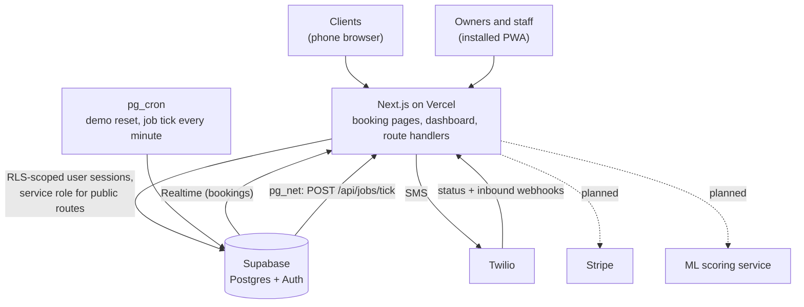
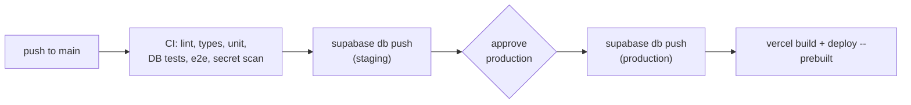

<div align="center">

# Fullcut

**Booking and scheduling for independent barbers and stylists who already have their own clients.**

Flat price. Zero commission. Your clients stay yours. And the app actively fills your chair.


</div>

---

## Why Fullcut

Square Appointments, Booksy, Fresha, Vagaro and StyleSeat charge established professionals new-client commissions, add-on fees and marketplace listings next to their competitors. Fullcut is the opposite:

- **No commission on clients, ever.** Fees are shown before they are charged.
- **The shop owns its data.** Full CSV export of clients, services and bookings, always.
- **Frictionless for clients.** No account, no app download, mobile-first, three steps or fewer.

### Differentiating features

| Feature                             | What it does                                                                           |
| ----------------------------------- | -------------------------------------------------------------------------------------- |
| No-show prediction                  | Scores every booking; only risky ones get extra friction (confirmation text, deposit). |
| "Who's due" rebooking               | Learns each client's visit rhythm and nudges overdue clients with open slots.          |
| Honest source tracking              | Records where each booking came from (Instagram, referral, Google, returning client).  |
| Learned durations + gap-aware slots | Learns how long each stylist really takes and suggests times that avoid dead gaps.     |
| Zero double bookings                | Enforced by the database, not just the app.                                            |
| One-click migration                 | Imports clients, services and history from competitor exports.                         |
| Branded booking page                | The shop controls it. No marketplace, no competitor listings.                          |

> **Status:** in development and deployed. The web app (public booking pages, dashboard, client book and export), the Supabase database and the deploy pipeline are in place, and the dashboard installs as a PWA. The ML service, Stripe and Twilio are planned and not built yet.

## Tech stack

| Layer    | Choice                                             | Status  |
| -------- | -------------------------------------------------- | ------- |
| Web app  | Next.js (App Router), TypeScript, Tailwind, shadcn | Present |
| Tests    | Vitest (unit), Playwright (e2e)                    | Present |
| Database | Supabase (Postgres, Auth, row-level security)      | Present |
| Payments | Stripe Connect                                     | Planned |
| SMS      | Twilio (Messaging Service, two-way replies)        | Present |
| ML       | Python, FastAPI, scikit-learn / LightGBM           | Planned |
| Hosting  | Vercel (web), Supabase cloud (database, auth)      | Present |
| Hosting  | Railway or Fly.io (ML)                             | Planned |

## Getting started

**Requirements:** Node 24 (see `.nvmrc`) and pnpm 12 (pinned in `package.json`; `corepack enable` will pick it up).

```bash
pnpm install
pnpm db:start
cp .env.example apps/web/.env.local   # then fill in the Supabase values below
pnpm dev
```

Open <http://localhost:3000>.

For local development, `apps/web/.env.local` needs `NEXT_PUBLIC_SUPABASE_URL`, `NEXT_PUBLIC_SUPABASE_PUBLISHABLE_KEY` and `SUPABASE_SECRET_KEY`. Take them from `pnpm exec supabase status` (`API_URL`, `PUBLISHABLE_KEY`, `SECRET_KEY`). The other variables are optional locally. Never commit real values.

Texts are only logged (never sent) unless `MESSAGING_MODE=twilio`. To process queued texts locally, set `JOBS_SECRET` (32+ random characters) and run `pnpm jobs:dev` next to `pnpm dev`. See [Text messages](#text-messages-twilio).

### Local database

Requires Docker. The Supabase CLI is a dev dependency, so `pnpm install` provides it.

```bash
pnpm db:start   # Postgres, Auth and Studio (http://127.0.0.1:55323)
pnpm db:reset   # rebuild from migrations + seed
pnpm db:test    # database tests + concurrency test
```

Local ports use 553xx instead of Supabase's default 543xx, because Windows/Hyper-V often reserves the 543xx range. Run `pnpm exec supabase status` for the local URL and keys.

The seed creates two shops with fake data and one owner login each. **These credentials exist only in your local database:**

| Shop         | Email                            | Password               |
| ------------ | -------------------------------- | ---------------------- |
| Demo Barbers | `owner@demo-barbers.example.com` | `demo-owner-password`  |
| Other Shop   | `owner@other-shop.example.com`   | `other-owner-password` |

## Commands

Run everything from the repository root.

| Command             | Purpose                                     |
| ------------------- | ------------------------------------------- |
| `pnpm dev`          | Run the web app locally                     |
| `pnpm jobs:dev`     | Tick `/api/jobs/tick` every 15 s locally    |
| `pnpm lint`         | ESLint (warnings fail)                      |
| `pnpm typecheck`    | `next typegen` then `tsc --noEmit`          |
| `pnpm test`         | Vitest unit tests                           |
| `pnpm test:e2e`     | Playwright e2e on desktop and mobile Chrome |
| `pnpm format`       | Format the repo with Prettier               |
| `pnpm format:check` | Check formatting without writing            |
| `pnpm db:start`     | Start local Supabase (Docker)               |
| `pnpm db:stop`      | Stop local Supabase                         |
| `pnpm db:reset`     | Rebuild local DB from migrations and seed   |
| `pnpm db:test`      | pgTAP database tests + concurrency test     |
| `pnpm db:types`     | Regenerate `apps/web/lib/database.types.ts` |

`pnpm --filter web check:bundle` scans the last build's browser bundle for server secrets (run `pnpm --filter web build` first).

One-time setup for e2e: `pnpm --filter web exec playwright install chromium`.

Add a shadcn/ui component: `pnpm --filter web exec shadcn add <component>`.

## Project layout

```
fullcut/
├── apps/
│   └── web/            Next.js app: booking pages and shop dashboard
│       ├── app/        routes and layouts
│       ├── components/ UI (shadcn/ui in components/ui)
│       ├── lib/        domain logic as plain, testable functions
│       └── tests/      unit/ (Vitest), e2e/ (Playwright), db/ (DB integration)
├── supabase/           migrations, seed.sql, database tests (pgTAP)
├── docs/adr/           architecture decision records
└── .github/            CI workflow, AGENTS.md and agent skills
```

`services/ml/` will be added when the ML service is built.

## Architecture



## Environments

| Environment | Web                                   | Database                    | Data                       |
| ----------- | ------------------------------------- | --------------------------- | -------------------------- |
| Local       | `pnpm dev` on <http://localhost:3000> | Supabase in Docker          | `supabase/seed.sql` (fake) |
| CI          | `next build` + `next start` for e2e   | Supabase in Docker          | `supabase/seed.sql` (fake) |
| Preview     | Vercel preview URL per pull request   | Staging Supabase project    | Test data only, never prod |
| Production  | Your domain, deployed by `deploy.yml` | Production Supabase project | Real shops + the demo shop |

## Deployment

Pull requests get a Vercel preview that talks to the **staging** Supabase project. Merging to `main` runs [.github/workflows/deploy.yml](.github/workflows/deploy.yml):



- Migrations run before the new code is deployed, so they must keep working with the previous app version (add first, remove in a later release).
- `seed.sql` is never pushed to a cloud project.
- Vercel's own auto-deploy of `main` is off ([apps/web/vercel.json](apps/web/vercel.json)); production only ships through the workflow.
- To apply migrations by hand: `pnpm exec supabase link --project-ref <ref>` then `pnpm exec supabase db push`.

Security headers (CSP, HSTS, frame and referrer policies) live in [apps/web/next.config.ts](apps/web/next.config.ts). See [ADR 0007](docs/adr/0007-deployment-and-demo-shop.md) for the reasoning.

### Demo shop

Production has a shared, writable demo shop with fake data, rebuilt every night at 08:00 UTC. To set it up once:

1. In the production Supabase dashboard, **Authentication → Users → Add user**: an email such as `demo@<your-domain>`, any long password, **Auto Confirm User** on. Copy the user's UID.
2. In the **SQL Editor**, run `select private.configure_demo_shop('<uid>', 'fullcut-demo');`. The second argument is the demo booking page slug.
3. In Vercel (Production), set `DEMO_USER_ID`, `DEMO_USER_EMAIL`, `DEMO_PASSWORD` (any long random string; mark it Sensitive) and `DEMO_SHOP_SLUG`, then redeploy.

The home page then shows **Open the demo dashboard** and **See a booking page**. To reset the demo immediately, run `select private.reset_demo_shop();`.

### Text messages (Twilio)

Booking changes queue texts in `scheduled_messages`; pg_cron calls `/api/jobs/tick` every minute to send them ([ADR 0008](docs/adr/0008-background-jobs-and-messaging.md)). The demo shop is never texted. Per environment (staging first):

1. In Twilio: buy a number, create a Messaging Service with it in the sender pool, and (on a trial account) verify each phone you will text under **Verified Caller IDs**.
2. In Vercel, set `TWILIO_ACCOUNT_SID`, `TWILIO_AUTH_TOKEN` (Sensitive), `TWILIO_MESSAGING_SERVICE_SID`, `JOBS_SECRET` (Sensitive, 32+ random characters) and, where real texts should go out, `MESSAGING_MODE=twilio`. Redeploy.
3. In the Supabase **SQL Editor** for that project:
   ```sql
   select vault.create_secret('https://<deployment-host>/api/jobs/tick', 'jobs_tick_url');
   select vault.create_secret('<same value as JOBS_SECRET>', 'jobs_secret');
   ```
   To change one later: `select vault.update_secret((select id from vault.secrets where name = 'jobs_secret'), '<new value>');`.
4. In the Messaging Service, **Integration → Incoming messages → Send a webhook**: `https://<deployment-host>/api/webhooks/twilio/inbound` (POST). Delivery callbacks are set per message automatically.

Check it works: `select * from net._http_response order by created desc limit 5;` should show 200s from the tick.

### Installing the dashboard (PWA)

- iPhone/iPad: open the site in Safari, then **Share → Add to Home Screen**.
- Android: open it in Chrome, then **⋮ → Install app** (the dashboard also offers an Install button).

The service worker only caches static files and an offline page; booking data always comes from the network.

## Quality gates

| Where      | What runs                                                                                                                                                       |
| ---------- | --------------------------------------------------------------------------------------------------------------------------------------------------------------- |
| Editor     | ESLint fix on save; recommended extensions in `.vscode/extensions.json`                                                                                         |
| Pre-commit | Husky + lint-staged: ESLint and Prettier on staged files                                                                                                        |
| CI (PRs)   | Format check, lint, typecheck, unit tests, production build, bundle secret scan; separate jobs for database tests and Playwright e2e against a production build |
| Deploy     | CI again, then staging migrations, then (after approval) production migrations and the Vercel deploy                                                            |

### VS Code status bar buttons

Install the recommended extensions when prompted. The Action Buttons extension adds coloured Dev, Lint, Types, Test and E2E buttons to the status bar. Add more in `.vscode/settings.json` under `actionButtons.commands`, ideally pointing at a `pnpm` script.

## Contributing

- Branch from `main` and open a pull request; CI must pass.
- Follow the product principles and critical invariants in [.github/AGENTS.md](.github/AGENTS.md). That file is also the guide for AI coding agents working in this repo.
- Record significant architecture decisions in [docs/adr](docs/adr).
