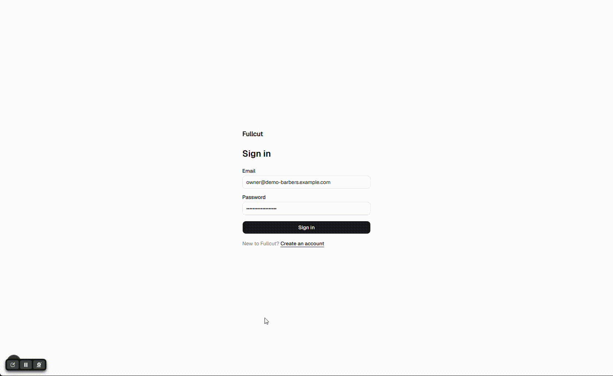
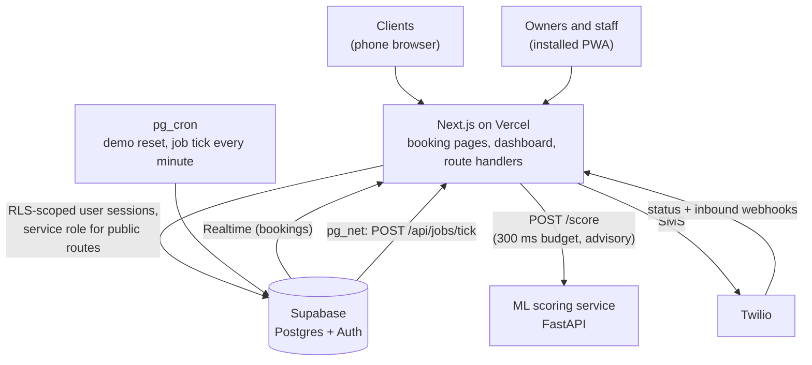
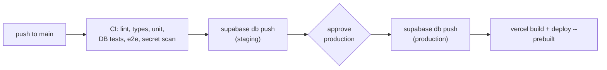

<div align="center">

# Fullcut

**Booking and scheduling for independent barbers and stylists who already have their own clients.**

Flat price. Zero commission. Your clients stay yours. And the app actively fills your chair.

**[Live demo → fullcut.ca](https://fullcut.ca)** (one click, no sign-up; the demo shop resets every night)


</div>



---

Square Appointments, Booksy, Fresha, Vagaro and StyleSeat charge established professionals new-client commissions, add-on fees, and list them in marketplaces next to their competitors. Fullcut is the opposite: a branded booking page the shop controls, no commission ever, a full data export, and features that work to keep the chair full: it spots bookings likely to be missed, asks only those clients to confirm, and texts the waitlist when a slot frees up.

The case study, with the problem, the hardest engineering problems and the results, is in [docs/case-study.md](docs/case-study.md).

## What it does

| Feature                         | What it does                                                                                                                      | Status  |
| ------------------------------- | --------------------------------------------------------------------------------------------------------------------------------- | ------- |
| Branded booking page            | Service → time → confirm, no account or app. No marketplace, no competitor listings.                                              | Shipped |
| Zero double bookings            | Enforced by a Postgres exclusion constraint, not just the app.                                                                    | Shipped |
| Dashboard (PWA)                 | Calendar, today view, outcomes, clients, inbox. Installs on iPhone, iPad and Android.                                             | Shipped |
| Text messages                   | Confirmations and reminders by SMS (Twilio), with quiet hours, STOP handling and two-way replies.                                 | Shipped |
| Waitlist refill                 | When a slot frees up, matching waitlisted clients get a text; the first to tap books it.                                          | Shipped |
| No-show prediction              | Scores every booking; only risky ones get extra friction (confirmation request, confirm-or-release, standby suggestions). Opt-in. | Shipped |
| Data ownership                  | Full CSV export of clients, services and bookings; client anonymisation and merge.                                                | Shipped |
| "Who's due" rebooking           | Learns each client's visit rhythm and nudges overdue clients with open slots.                                                     | Planned |
| Honest source tracking          | Reports where bookings came from (Instagram, referral, Google, returning). The source is already recorded on every booking.       | Planned |
| One-click migration             | Imports clients, services and history from competitor exports.                                                                    | Planned |
| Learned durations + smart slots | Learns how long each stylist really takes and suggests times that avoid dead gaps.                                                | Planned |

## Engineering highlights

- **Double bookings are impossible, not just unlikely.** A `bookings_no_overlap` exclusion constraint on each staff member's blocked time range ([core_schema.sql](supabase/migrations/20261019011748_core_schema.sql#L120)). Concurrent inserts on an exclusion constraint can deadlock, so a per-staff advisory lock trigger serialises them ([bookings_staff_write_lock.sql](supabase/migrations/20261019013909_bookings_staff_write_lock.sql)). A test fires 10 simultaneous transactions at the same slot and asserts exactly one wins ([booking-concurrency.test.ts](apps/web/tests/db/booking-concurrency.test.ts)); the API turns SQLSTATE `23P01` into "that time was just taken" with the nearest open times.
- **Tenant isolation in the database.** Every tenant table has `shop_id`, row-level security and member-only policies; same-shop references use composite foreign keys so a booking can't point at another shop's client ([ADR 0002](docs/adr/0002-cross-shop-integrity-composite-fks.md)). pgTAP tests prove another shop can't read or write each table ([02_rls_tenant_tables.test.sql](supabase/tests/database/02_rls_tenant_tables.test.sql)), and a test fails if a new tenant table is missing from the data export ([export-coverage.test.ts](apps/web/tests/db/export-coverage.test.ts)).
- **DST-safe scheduling.** Instants are stored in UTC, working hours as shop-local wall-clock times, and only one module touches the time library ([ADR 0003](docs/adr/0003-time-library.md)). Slot generation is a pure function with spring-forward and fall-back tests ([generate-slots.test.ts](apps/web/tests/unit/booking/generate-slots.test.ts#L263)) and property-based tests ([properties.test.ts](apps/web/tests/unit/booking/properties.test.ts)).
- **Idempotent, verified webhooks.** Twilio signatures are checked against the raw body, and each event ID is recorded once so retries are no-ops ([webhooks.ts](apps/web/lib/messaging/webhooks.ts#L35)).
- **Outbox worker.** A trigger queues texts in `scheduled_messages` in the same transaction as the booking change; `pg_cron` ticks the app every minute, and the worker claims rows with `FOR UPDATE SKIP LOCKED` so overlapping ticks never send twice ([messaging.sql](supabase/migrations/20261020022610_messaging.sql#L244), [ADR 0008](docs/adr/0008-background-jobs-and-messaging.md)).
- **Race-free waitlist claims.** When several clients tap the same offer, a single SQL function decides the winner and books the slot atomically ([waitlist_refill.sql](supabase/migrations/20261020160000_waitlist_refill.sql#L357), [ADR 0009](docs/adr/0009-waitlist-refill.md)).
- **ML pipeline with honest evaluation.** One feature module shared by training and serving ([features.py](services/ml/fullcut_ml/features.py#L54)), a time-based split (never random) ([train.py](services/ml/fullcut_ml/train.py#L64)), a leakage test, and a regression test that fails if model quality drops.
- **ML never blocks a booking, and stays fair.** Scoring has a 300 ms budget and runs after the response; on failure the booking proceeds unscored ([ADR 0010](docs/adr/0010-risk-scoring.md)). Age, gender and location are dropped at the adapter, every action is opt-in per shop, owners can trust a client with one tap, and clients who keep confirming and showing up stop being asked ([fairness.ts](apps/web/lib/risk/fairness.ts)).
- **Public endpoints are rate limited** per IP and per phone with hashed keys ([rate-limit.ts](apps/web/lib/public-booking/rate-limit.ts), [ADR 0005](docs/adr/0005-public-booking-links-and-rate-limits.md)); security headers and CSP in [next.config.ts](apps/web/next.config.ts); CI scans the client bundle for server secrets.

### Tests

| Suite                                    | Count                         | Command         |
| ---------------------------------------- | ----------------------------- | --------------- |
| Unit + component (Vitest)                | 519 tests in 35 files         | `pnpm test`     |
| Database (pgTAP: RLS, constraints, RPCs) | 462 tests in 18 files         | `pnpm db:test`  |
| DB integration (Vitest, real Postgres)   | 110 tests in 12 files         | `pnpm db:test`  |
| End-to-end (Playwright, incl. axe)       | 22 tests × desktop and mobile | `pnpm test:e2e` |
| ML (pytest)                              | 54 tests                      | `uv run pytest` |

## No-show model results

Prototype trained on the public Kaggle "Medical Appointment No Shows" dataset (110,522 clinic bookings), not on salon data. Time-based split; the test week (26,451 bookings) was never used for training or model choice. Full report: [docs/ml/noshow-prototype.md](docs/ml/noshow-prototype.md); raw numbers: [noshow-prototype-metrics.json](docs/ml/noshow-prototype-metrics.json).

| Model                               | ROC AUC   | PR AUC    | Top-20% precision | Top-20% recall |
| ----------------------------------- | --------- | --------- | ----------------- | -------------- |
| Random                              | 0.500     | 0.185     | 18.5%             | 20.0%          |
| Baseline (client's no-show history) | 0.557     | 0.220     | 21.5%             | 23.3%          |
| **Logistic regression** (selected)  | **0.707** | **0.302** | **31.3%**         | **33.9%**      |
| LightGBM                            | 0.702     | 0.296     | 30.8%             | 33.3%          |

Caveat: most of the lift comes from same-day bookings. For bookings made at least a day ahead, top-20% recall is 24.3% against the baseline's 22%. Because of this, shops are scored by a transparent heuristic until they have enough of their own labelled bookings; the Kaggle model is never enabled for real shops.

## Architecture



| Layer    | Choice                                                       | Why                                                                                                                                                                 |
| -------- | ------------------------------------------------------------ | ------------------------------------------------------------------------------------------------------------------------------------------------------------------- |
| Web app  | Next.js (App Router), TypeScript strict, Tailwind, shadcn/ui | One app serves the public booking pages and the dashboard; server components keep secrets on the server ([ADR 0001](docs/adr/0001-monorepo-and-web-toolchain.md)).  |
| Database | Supabase (Postgres, Auth, RLS, Realtime)                     | Invariants live in the database: exclusion constraints, RLS, composite FKs. Realtime keeps the calendar live ([ADR 0004](docs/adr/0004-auth-and-authorization.md)). |
| Jobs     | pg_cron + pg_net calling a route handler                     | No extra job service; queues are tables in the same transaction as the change ([ADR 0008](docs/adr/0008-background-jobs-and-messaging.md)).                         |
| SMS      | Twilio Messaging Service                                     | Two-way replies (YES / STOP) and delivery callbacks.                                                                                                                |
| Time     | Luxon behind one module                                      | IANA zones and DST handled by a library, never by offsets ([ADR 0003](docs/adr/0003-time-library.md)).                                                              |
| ML       | Python 3.12, scikit-learn, LightGBM, FastAPI, uv             | The standard ML tooling; a separate service so a slow model can't slow the app ([ADR 0010](docs/adr/0010-risk-scoring.md)).                                         |
| Tests    | Vitest, pgTAP, Playwright + axe, pytest                      | Each layer tested where its logic lives.                                                                                                                            |
| Hosting  | Vercel (web), Supabase cloud                                 | Previews per pull request against a staging database ([ADR 0007](docs/adr/0007-deployment-and-demo-shop.md)).                                                       |

## Getting started

**Requirements:** Node 24, pnpm 12 (via corepack), Docker. Optional for risk scores: [uv](https://docs.astral.sh/uv/).

```bash
corepack enable
pnpm install
pnpm db:start                              # Postgres, Auth, Studio; applies migrations + seed
cp .env.example apps/web/.env.local        # fill the Supabase values from the next command
pnpm exec supabase status                  # API_URL, PUBLISHABLE_KEY, SECRET_KEY
pnpm dev                                   # http://localhost:3000
```

Sign in at <http://localhost:3000/login> with a seed login (local database only):

| Shop         | Email                            | Password               |
| ------------ | -------------------------------- | ---------------------- |
| Demo Barbers | `owner@demo-barbers.example.com` | `demo-owner-password`  |
| Other Shop   | `owner@other-shop.example.com`   | `other-owner-password` |

`apps/web/.env.local` needs `NEXT_PUBLIC_SUPABASE_URL`, `NEXT_PUBLIC_SUPABASE_PUBLISHABLE_KEY` and `SUPABASE_SECRET_KEY`; everything else is optional locally. Never commit real values.

- **Texts** are only logged unless `MESSAGING_MODE=twilio`. To process queued texts locally, set `JOBS_SECRET` (32+ characters) and run `pnpm jobs:dev` next to `pnpm dev`.
- **Risk scores** need the scoring service and `ML_SERVICE_URL` + `ML_SHARED_SECRET` in `apps/web/.env.local`:
  ```bash
  cd services/ml && uv sync && ML_SHARED_SECRET=<same 32+ chars> uv run uvicorn fullcut_ml.serve:create_app --factory
  ```
  Without them nothing is scored and bookings work as usual.

Local Supabase ports are 553xx instead of 543xx, because Windows/Hyper-V often reserves the 543xx range.

## Commands

Run everything from the repository root.

| Command                         | Purpose                                                       |
| ------------------------------- | ------------------------------------------------------------- |
| `pnpm dev`                      | Run the web app locally                                       |
| `pnpm jobs:dev`                 | Tick `/api/jobs/tick` every 15 s locally                      |
| `pnpm lint`                     | ESLint (warnings fail)                                        |
| `pnpm typecheck`                | `next typegen` then `tsc --noEmit`                            |
| `pnpm test`                     | Vitest unit tests                                             |
| `pnpm test:e2e`                 | Playwright e2e (with axe checks) on desktop and mobile Chrome |
| `pnpm format` / `format:check`  | Prettier                                                      |
| `pnpm audit`                    | Audit production dependencies                                 |
| `pnpm db:start` / `db:stop`     | Start / stop local Supabase (Docker)                          |
| `pnpm db:reset`                 | Rebuild local DB from migrations and seed                     |
| `pnpm db:test`                  | pgTAP database tests + DB integration tests                   |
| `pnpm db:types`                 | Regenerate `apps/web/lib/database.types.ts`                   |
| `pnpm --filter web screenshots` | Refresh the landing-page screenshots from the local demo shop |

`pnpm --filter web check:bundle` scans the last build's browser bundle for server secrets (run `pnpm --filter web build` first). One-time setup for e2e: `pnpm --filter web exec playwright install chromium`. [supabase/snippets/perf-large-shop.sql](supabase/snippets/perf-large-shop.sql) loads ~850k bookings into a rolled-back transaction and prints query plans for the dashboard's hot queries.

ML service (from `services/ml`): `uv run pytest`, `uv run ruff check .`, `uv run python -m fullcut_ml.train` (needs the Kaggle CSV in `data/raw/`, never committed).

## Project layout

```
fullcut/
├── apps/web/           Next.js app: booking pages and shop dashboard
│   ├── app/            routes and layouts
│   ├── components/     UI (shadcn/ui in components/ui)
│   ├── lib/            domain logic as plain, testable functions
│   └── tests/          unit/ (Vitest), db/ (against local Postgres), e2e/ (Playwright)
├── services/ml/        no-show model: features, training, FastAPI scoring service
├── supabase/           migrations, seed.sql, pgTAP tests, snippets
├── docs/               ADRs, ML report, case study
└── .github/            CI/CD workflows, AGENTS.md, agent skills and milestones
```

## Environments

| Environment | Web                                   | Database                    | Data                       |
| ----------- | ------------------------------------- | --------------------------- | -------------------------- |
| Local       | `pnpm dev` on <http://localhost:3000> | Supabase in Docker          | `supabase/seed.sql` (fake) |
| CI          | `next build` + `next start` for e2e   | Supabase in Docker          | `supabase/seed.sql` (fake) |
| Preview     | Vercel preview URL per pull request   | Staging Supabase project    | Test data only, never prod |
| Production  | <https://fullcut.ca>                  | Production Supabase project | Real shops + the demo shop |

## Deployment

Pull requests get a Vercel preview that talks to the **staging** Supabase project. Merging to `main` runs [.github/workflows/deploy.yml](.github/workflows/deploy.yml):



- Migrations run before the new code is deployed, so they must keep working with the previous app version (add first, remove in a later release).
- `seed.sql` is never pushed to a cloud project.
- Vercel's own auto-deploy of `main` is off ([apps/web/vercel.json](apps/web/vercel.json)); production only ships through the workflow.
- To apply migrations by hand: `pnpm exec supabase link --project-ref <ref>` then `pnpm exec supabase db push`.

Security headers (CSP, HSTS, frame and referrer policies) live in [apps/web/next.config.ts](apps/web/next.config.ts). See [ADR 0007](docs/adr/0007-deployment-and-demo-shop.md) for the reasoning.

### Demo shop

Production has a shared, writable demo shop with fake data, rebuilt every night at 08:00 UTC. Signed-in demo visitors get a short guided tour. To set it up once:

1. In the production Supabase dashboard, **Authentication → Users → Add user**: an email such as `demo@<your-domain>`, any long password, **Auto Confirm User** on. Copy the user's UID.
2. In the **SQL Editor**, run `select private.configure_demo_shop('<uid>', 'fullcut-demo');`. The second argument is the demo booking page slug.
3. In Vercel (Production), set `DEMO_USER_ID`, `DEMO_USER_EMAIL`, `DEMO_PASSWORD` (any long random string; mark it Sensitive) and `DEMO_SHOP_SLUG`, then redeploy.

The home page then shows **Open the demo dashboard** and **See a booking page**. To reset the demo immediately, run `select private.reset_demo_shop();`.

### Text messages (Twilio)

Booking changes queue texts in `scheduled_messages`; pg_cron calls `/api/jobs/tick` every minute to send them ([ADR 0008](docs/adr/0008-background-jobs-and-messaging.md)). The demo shop is never texted. Per environment (staging first):

1. In Twilio: buy a number, create a Messaging Service with it in the sender pool, and (on a trial account) verify each phone you will text under **Verified Caller IDs**.
2. In Vercel, set `TWILIO_ACCOUNT_SID`, `TWILIO_AUTH_TOKEN` (Sensitive), `TWILIO_MESSAGING_SERVICE_SID`, `JOBS_SECRET` (Sensitive, 32+ random characters) and, where real texts should go out, `MESSAGING_MODE=twilio`. Redeploy.
3. In the Supabase **SQL Editor** for that project:
   ```sql
   select vault.create_secret('https://<deployment-host>/api/jobs/tick', 'jobs_tick_url');
   select vault.create_secret('<same value as JOBS_SECRET>', 'jobs_secret');
   ```
   To change one later: `select vault.update_secret((select id from vault.secrets where name = 'jobs_secret'), '<new value>');`.
4. In the Messaging Service, **Integration → Incoming messages → Send a webhook**: `https://<deployment-host>/api/webhooks/twilio/inbound` (POST). Delivery callbacks are set per message automatically.

Check it works: `select * from net._http_response order by created desc limit 5;` should show 200s from the tick.

### Installing the dashboard (PWA)

- iPhone/iPad: open the site in Safari, then **Share → Add to Home Screen**.
- Android: open it in Chrome, then **⋮ → Install app** (the dashboard also offers an Install button).

The service worker only caches static files and an offline page; booking data always comes from the network.

## Quality gates

| Where      | What runs                                                                                                                                                       |
| ---------- | --------------------------------------------------------------------------------------------------------------------------------------------------------------- |
| Editor     | ESLint fix on save; recommended extensions in `.vscode/extensions.json`                                                                                         |
| Pre-commit | Husky + lint-staged: ESLint and Prettier on staged files                                                                                                        |
| CI (PRs)   | Format check, lint, typecheck, unit tests, production build, bundle secret scan; separate jobs for database tests, Playwright e2e (with axe) and the ML service |
| Deploy     | CI again, then staging migrations, then (after approval) production migrations and the Vercel deploy                                                            |
| Weekly     | Dependabot updates for npm, uv and GitHub Actions                                                                                                               |

## Contributing

- Branch from `main` and open a pull request; CI must pass.
- Follow the product principles and critical invariants in [.github/AGENTS.md](.github/AGENTS.md). That file is also the guide for AI coding agents working in this repo.
- Record significant architecture decisions in [docs/adr](docs/adr).
