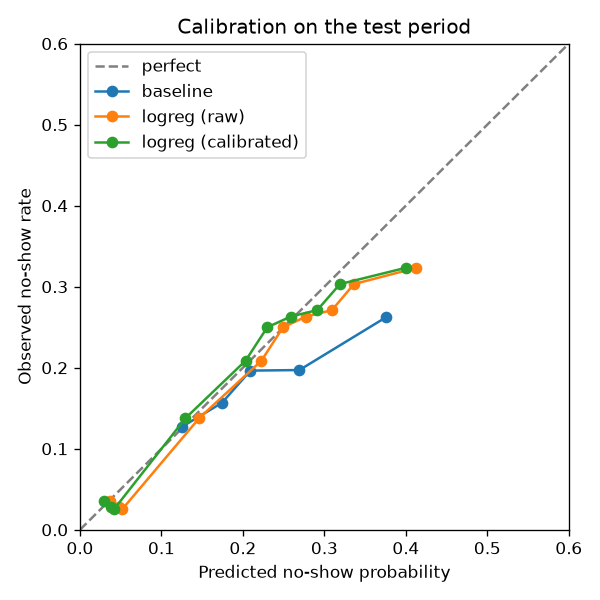

# No-show prediction: offline prototype

**Version:** `2026-10-20-logreg-1` · **Data:** public Kaggle "Medical Appointment No Shows" (Brazil, 2016) · **Code:** [`services/ml`](../../services/ml) · **Raw numbers:** [noshow-prototype-metrics.json](noshow-prototype-metrics.json)

## In one minute

- **Problem:** when a client books and doesn't show up, the chair sits empty and the barber loses the money. If Fullcut can spot the risky bookings early, it can ask those clients to confirm and offer the slot to someone on the waitlist if they don't.
- **Result:** if the shop flags **1 in 5 bookings** (the riskiest 20%), it **catches 34% of the no-shows**. Picking bookings at random would catch 20%, and the simple "has this client missed before?" rule catches 23%. About **1 in 3 flagged bookings is a real no-show**, against fewer than 1 in 5 for bookings overall.
- **Honest caveat:** most of that lift comes from one fact: people who book for the same day almost always come. If you only look at bookings made at least a day ahead, the model is still better than the simple rule, but only a little (24% of no-shows caught vs 22%). Clinic data is a stand-in. The real test is Fullcut's own salon data.

## Problem

Predict, at the moment a booking is made, the probability that the client won't show up. The score is **advisory**: it decides how much friction a booking gets (a "reply YES" text, confirm-or-release). It never refuses a booking, and the owner can always override it.

## Data

|                    |                                                                                                   |
| ------------------ | ------------------------------------------------------------------------------------------------- |
| Source             | Kaggle "Medical Appointment No Shows", 110,527 rows (5 dropped: booked after the appointment day) |
| Bookings / clients | 110,522 / 62,299                                                                                  |
| Appointments       | 2016-04-29 to 2016-06-08 (6 weeks; date only, no time of day)                                     |
| Bookings made      | 2015-11-10 to 2016-06-08                                                                          |
| No-show rate       | 20.2% overall, 18.5% in the test period                                                           |

The dataset is loaded through an adapter into the same `BookingRecord` shape Fullcut stores (`client_id`, `created_at`, `starts_at`, `status`, …), so the feature code runs unchanged on Fullcut's own bookings later. Exploration: [`01_explore.ipynb`](../../services/ml/notebooks/01_explore.ipynb).

## Features

All features are computed **as of the moment of booking**. Client history only counts appointments whose outcome was already known then. A test checks this: adding future bookings to the data doesn't change any feature.

| Feature                                                     | Why                                                                                       |
| ----------------------------------------------------------- | ----------------------------------------------------------------------------------------- |
| Lead time (days), same-day flag                             | The strongest signal: plans change over weeks                                             |
| Prior bookings, prior no-shows, prior late cancellations    | Past behaviour                                                                            |
| Smoothed no-show rate                                       | Client's rate pulled toward the shop average when history is short (3 visits isn't proof) |
| Missed their last visit, days since last visit, first visit | Recency                                                                                   |
| Weekday, local hour                                         | Timing (no hour in this dataset)                                                          |
| Reminder SMS sent, confirm requested, replied               | Contact signals (only SMS exists here)                                                    |
| Price, duration, booking source, shop base rate             | Fullcut-only; empty or constant here                                                      |

**Excluded on purpose:** age, gender, neighbourhood, and the health/welfare flags (scholarship, hypertension, diabetes, alcoholism, disability). Fullcut's fairness rules forbid using who someone is or where they live to add friction to their booking. Salons don't collect these anyway. The adapter drops these columns, so no later code can use them by accident.

## Method

- **Time-based split**, never random (a random split leaks the future): train on appointments up to 19 May, use 20–31 May to calibrate and choose between models, and test on 1–8 June (26,451 bookings never seen before).
- **Baseline:** the client's smoothed historical no-show rate. A model has to beat this to be worth shipping.
- **Models:** logistic regression and LightGBM (gradient-boosted trees), both on the same features.
- **Calibration:** Platt scaling fitted on the calibration period. It changes the probabilities but not the ranking.
- **Selection:** the model with the best PR AUC on the calibration period. The test period isn't used to choose.

## Results (test period, 1–8 June)

| Model                              | ROC AUC   | PR AUC    | Brier ↓    | Top-20% precision | Top-20% recall |
| ---------------------------------- | --------- | --------- | ---------- | ----------------- | -------------- |
| Random                             | 0.500     | 0.185     | —          | 18.5%             | 20.0%          |
| Baseline (smoothed history)        | 0.557     | 0.220     | 0.1501     | 21.5%             | 23.3%          |
| **Logistic regression** (selected) | **0.707** | **0.302** | **0.1385** | **31.3%**         | **33.9%**      |
| LightGBM                           | 0.702     | 0.296     | 0.1385     | 30.8%             | 33.3%          |

How to read it: **precision** = of the flagged bookings, how many really didn't show. **Recall** = of all no-shows, how many were flagged. **PR AUC** summarises both across every threshold and is the main metric, because no-shows are the minority. **Brier** measures how close the probabilities are to what actually happened (lower is better).

**Slices (selected model):**

| Slice                | Bookings | No-show rate | ROC AUC | PR AUC | Top-20% recall | Baseline PR AUC |
| -------------------- | -------- | ------------ | ------- | ------ | -------------- | --------------- |
| First visit          | 14,440   | 19.7%        | 0.692   | 0.300  | 31.6%          | 0.197           |
| Returning            | 12,011   | 17.0%        | 0.720   | 0.305  | 36.7%          | 0.241           |
| Booked ≥ 1 day ahead | 17,346   | 26.0%        | 0.564   | 0.302  | 24.3%          | 0.281           |

The model works for first-time clients too, where history-based rules can't say anything. Performance on bookings made ahead is much weaker (see limitations).

**Calibration:**



Up to about 30% predicted risk, a booking scored at X% really is missed about X% of the time. The riskiest bucket is over-predicted (40% predicted vs 32% observed) because no-shows were lower in June than in May. Platt scaling made a small improvement (Brier 0.1389 → 0.1385). LightGBM ranks lead time, same-day, days since last visit and the smoothed history rate as its top signals.

**Verdict:** both models beat the baseline on PR AUC (0.302 vs 0.220). Logistic regression is as good as LightGBM here and simpler to explain, so it's the prototype's pick.

## Limitations

- **Clinic, not salon.** These are free public-clinic appointments in Brazil. Salon clients pay, rebook every 3–6 weeks and have stronger history. These weights must not be shipped to shops as if they described salons.
- **Same-day bookings carry the result.** 34% of test bookings were made the same day, and only about 7% of those were missed. Without them, ROC AUC drops to 0.56. In a salon, walk-ins are entered while the client is in the chair, so this easy signal shrinks.
- **Thin history.** Appointments cover only 6 weeks, while bookings were made up to 7 months ahead. At booking time, 72% of bookings had no known prior outcome. History features should matter far more with real, longer data.
- **No time of day, price, source or confirmation replies** in this dataset, so those features are untested here.
- **SMS is confounded.** Reminders were only sent for bookings made days ahead, so "got an SMS" looks riskier. That's lead time showing through, not the SMS causing no-shows.
- **One period.** One week of test data. Seasonal effects and drift (the no-show rate fell from 21% to 18.5%) aren't covered.

## Next steps

1. Put this pipeline behind the scoring service (milestone 12), starting with a transparent heuristic until each shop has its own labelled bookings.
2. Retrain on Fullcut's own completed/no-show bookings, pooled across shops, and promote a model only if it isn't worse than the current one on the same time-based holdout.
3. Re-score 48 h before the appointment, when "replied YES" becomes available. That is likely the strongest salon-specific signal.
4. Track how many high-risk bookings get released for not confirming: they have no label, which biases later training data.

## Reproduce

```bash
cd services/ml
uv sync
# put KaggleV2-May-2016.csv in data/raw/ (Kaggle account needed; never committed)
uv run python -m fullcut_ml.train   # writes artifacts/<version>/ and refreshes this folder's metrics + plot
uv run pytest                       # includes the leakage test and the AUC regression test
```
